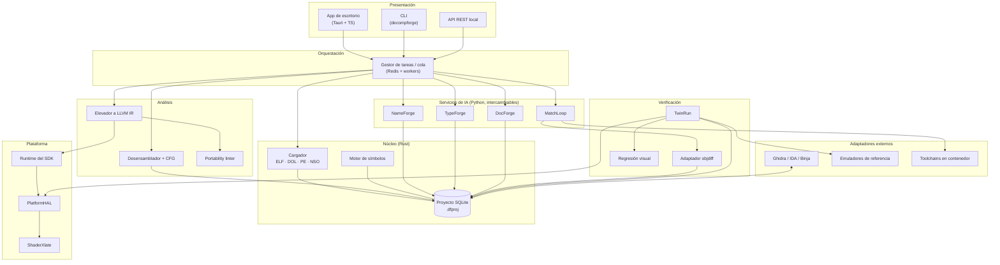

# Fase 0 — Descubrimiento y diseño

Entregables pedidos por el prompt de la Fase 0 (Documento Maestro §2.2):
(1) diagrama de componentes, (2) requisitos numerados, (3) riesgos técnicos
priorizados, (4) ADR de las elecciones más importantes.

Origen: `docs/original/DecompForge_Documento_Maestro.docx` v1.0 (octubre 2026).

---

## 1. Diagrama de componentes

**Estado tras la Fase 1:** implementados `Cargador` (ELF, DOL, PE y NSO con
LZ4), `Desensamblador` (Capstone) con detección recursiva de funciones, llamadas,
bloques básicos y CFG, `Proyecto SQLite` y `CLI` (init/load/analyze/info/export).
El resto son carpetas con README.

**Estado tras la Fase 2:** añadidos el documento bidireccional `re-1.0`
(`export`/`updates`), los comandos `export --format re-json` y `apply`, la
migración SQLite v2 (firmas y comentarios por dirección), el cliente Python de
validación/normalización y los scripts de exportación e importación de Ghidra.
El formato está validado por pruebas en Rust, Python y CI
([ADR-012](adr/ADR-012-esquema-re-y-adaptadores.md)).

**Estado tras la Fase 3:** añadido el servicio NameForge: el módulo `nameforge`
(contexto acotado, proveedor heurístico y comando externo, estilo configurable),
la migración SQLite v4 (`ai_suggestion` ampliada), los métodos de proyecto
`suggest_names`, `suggestions`, `accept_suggestion` y `reject_suggestion`, el
comando CLI `name` (batch, interactivo, list, accept, reject, config) y el
servicio Python `ai/nameforge` (heurístico y proveedor OpenAI-compatible por
`urllib`). Ninguna propuesta cambia un nombre sin aceptación explícita; aceptar
sobre una función ya nombrada exige `--force`.
El formato está validado por pruebas en Rust, Python y CI
([ADR-012](adr/ADR-012-esquema-re-y-adaptadores.md)).

**Flujo de extremo a extremo (§5.2):** binario del usuario → cargador → análisis →
servicios de IA proponen → verificación automática → consolidación en el proyecto →
capa de plataforma → TwinRun → documentación y métricas.

---

## 2. Requisitos

### 2.1 Funcionales

| ID | Requisito | Prioridad | Estado |
| --- | --- | --- | --- |
| RF-01 | Cargar ELF, SELF/NSO, DOL, XEX, PE y ROM planas aportadas por el usuario | Alta | **Parcial** (ELF, DOL, PE, NSO con LZ4, ROM plana; XEX reconocido sin cargador; SELF rechazado por diseño) |
| RF-02 | Detectar arquitectura (MIPS, PPC, ARM, ARM64, x86-64, SPU) y endianness | Alta | **Hecho** (por cabeceras) |
| RF-03 | Base de datos de funciones, símbolos, tipos y progreso | Alta | **Hecho** (esquema v3: funciones, llamadas, bloques básicos y CFG con *ownership* de instrucciones) |
| RF-04 | Proponer nombres con confianza y justificación | Alta | **Hecho** (NameForge: núcleo, CLI `name`, servicio Python `ai/nameforge` y migración v4) |
| RF-05 | Bucle de matching con toolchain fijado | Alta | Fase 4 |
| RF-06 | Elevar a LLVM IR y recompilar para el destino | Alta | Fase 5 |
| RF-07 | Capas de abstracción hacia SDL3, Vulkan, OpenGL y Metal | Media | Fase 6 |
| RF-08 | Traducir shaders a SPIR-V | Media | Fase 6 |
| RF-09 | Verificar equivalencia con emulador de referencia | Alta | Fase 7 |
| RF-10 | Detectar problemas de portabilidad (endianness, puntero, UB) | Alta | Fase 6 |
| RF-11 | Colaboración multiusuario con bloqueo de funciones | Media | Fase 9 |
| RF-12 | Exportar documentación y métricas | Media | **Parcial** (export JSON `1.0` y `re-1.0`; documentación y métricas pendientes) |
| RF-13 | Sistema de plugins para arquitecturas y herramientas | Media | Pendiente |
| RF-14 | CLI completa para CI | Alta | **Parcial** (6 de 9 comandos: init, load, analyze, info, export, apply) |
| RF-15\* | Rechazar binarios cifrados/firmados sin intentar descifrarlos | Alta | **Hecho** (ADR-007) |

### 2.2 No funcionales

| ID | Requisito | Criterio | Estado |
| --- | --- | --- | --- |
| RNF-01 | Rendimiento | Cargar 100 MB en < 60 s; UI fluida con 200 000 funciones | Sin medir (benchmarks criterion pendientes) |
| RNF-02 | Reproducibilidad | Mismas entradas → resultados idénticos bit a bit | **Verificado** para export JSON `1.0` y `re-1.0` (dos exportaciones byte a byte en CI), análisis recursivo, binarios sintéticos y cliente Python (orden y `LF` fijos) |
| RNF-03 | Seguridad | Compiladores y binarios en contenedores aislados | Cargadores y analizador sin *panic* ante entradas mutadas; contenedores pendientes |
| RNF-04 | Privacidad | Modo local; envío a IA opcional | Fase 3 |
| RNF-05 | Portabilidad | Windows, Linux y macOS | Matriz de CI en los tres sistemas ([ADR-011](adr/ADR-011-integracion-continua.md)); probado localmente en Windows 10 (GNU) y Linux |
| RNF-06 | Mantenibilidad | Cobertura ≥ 80 % en núcleo; API documentada | CI exige ≥ 80 % de líneas en `decompforge-core` con `cargo-llvm-cov`; medido en local con el toolchain MSVC el 2026-11-02 tras NameForge: **86,09 % de líneas** (`scripts/coverage.ps1`). `cargo doc` sin advertencias y `missing_docs` activo ([ADR-011](adr/ADR-011-integracion-continua.md)) |
| RNF-07 | Extensibilidad | Nueva arquitectura sin tocar el núcleo | Pendiente (plugins) |
| RNF-08 | Trazabilidad | Cada cambio de IA con origen y validación | Base lista (`audit_log` inmutable, `source.origin`; acción `analyze` auditable) |
| RNF-09\* | Robustez ante entradas malformadas | Ninguna entrada provoca *panic* | **Hecho** (fuzzing ligero de cargadores y análisis; cargo-fuzz pendiente para CI) |

\* Derivados del Documento Maestro (§7.1 y §12.3); no figuraban numerados.

---

## 3. Riesgos técnicos priorizados

Puntuación = probabilidad (1-5) × impacto (1-5). Ordenados de mayor a menor.

| # | Riesgo | P | I | Puntos | Mitigación | Cuándo |
| --- | --- | --- | --- | --- | --- | --- |
| 1 | **Sobrealcance** (4 consolas, 3 estrategias distintas) | 5 | 5 | 25 | Hoja de ruta por fases; PS2 primero; PS3 al final | Continuo |
| 2 | **Complejidad de PS3 (Cell: PPU + SPU)** | 5 | 5 | 25 | Fase tardía, pilotos pequeños, especialistas | Fase 10 |
| 3 | **Toolchains propietarios no distribuibles** (SN Systems, Metrowerks) \* | 4 | 4 | 16 | Solo GCC libre automatizado; el usuario aporta el resto | Fase 4 |
| 4 | **No determinismo del emulador** (temporización) en TwinRun \* | 4 | 4 | 16 | Sincronizar por eventos; tolerancias; modo serie | Fase 7 |
| 5 | **La IA produce resultados incorrectos** | 5 | 3 | 15 | Verificación automática obligatoria; la IA nunca decide | Fases 3-4 |
| 6 | **Riesgo legal** (derechos de autor, anti-elusión, EULA) | 3 | 5 | 15 | "Aporta tu copia", sin descifrado, asesoría legal desde ya | Antes de publicar |
| 7 | **Hardware poco documentado** (microcódigo VU, GS, RSX) | 5 | 3 | 15 | Intérpretes de referencia; comparar con emulador | Fases 6-7 |
| 8 | **Elevación a IR incorrecta** (semántica de instrucciones) \* | 3 | 5 | 15 | Pruebas de propiedades contra intérprete de referencia | Fase 5 |
| 9 | Brechas de seguridad en cargadores | 2 | 5 | 10 | Rust, fuzzing, sandbox | Continuo |
| 10 | Coste de IA | 3 | 3 | 9 | Presupuesto por función, caché, modelos locales | Fase 4 |
| 11 | Rendimiento (UI con 200 000 funciones; ports lentos) | 3 | 3 | 9 | Virtualización de listas; perfilado temprano | Fases 5-6 |
| 12 | Cambios de API de LLVM / dependencias de terceros | 3 | 3 | 9 | Versión fijada, adaptadores desacoplados | Fase 5 |

\* Añadidos en la Fase 0; no estaban en el §18 del documento.

---

## 4. Decisiones de arquitectura (ADR)

| ADR | Decisión |
| --- | --- |
| [ADR-001](adr/ADR-001-nucleo-en-rust.md) | Núcleo en Rust |
| [ADR-002](adr/ADR-002-python-para-ia.md) | Python para IA y scripts |
| [ADR-003](adr/ADR-003-sqlite-como-formato-de-proyecto.md) | SQLite como formato de proyecto |
| [ADR-004](adr/ADR-004-contenedores-para-toolchains.md) | Contenedores para compiladores antiguos |
| [ADR-005](adr/ADR-005-llvm-ir-como-representacion-intermedia.md) | LLVM IR como representación intermedia |
| [ADR-006](adr/ADR-006-ia-como-servicio-intercambiable.md) | IA como servicio intercambiable |
| [ADR-007](adr/ADR-007-rechazar-contenedores-protegidos.md) | Rechazar contenedores cifrados o firmados |
| [ADR-008](adr/ADR-008-cli-sin-framework-en-fase-1.md) | CLI con parser propio en la Fase 1 |
| [ADR-009](adr/ADR-009-modelo-de-proyecto-fase-1.md) | Decisiones del modelo de proyecto en la Fase 1 |
| [ADR-010](adr/ADR-010-capstone-y-deteccion-de-funciones.md) | Capstone y detección recursiva de funciones |
| [ADR-011](adr/ADR-011-integracion-continua.md) | Integración continua, documentación y cobertura |
| [ADR-012](adr/ADR-012-esquema-re-y-adaptadores.md) | Esquema de intercambio `re-1.0` y arquitectura de adaptadores |
| [ADR-013](adr/ADR-013-imagen-materializada-nso.md) | Imagen materializada para analizar NSO comprimido |
| [ADR-014](adr/ADR-014-cfg-ownership-y-delay-slots.md) | CFG, *ownership* de instrucciones y *delay slots* de MIPS |
| [ADR-015](adr/ADR-015-nameforge.md) | NameForge: nombres con confianza y justificación |

Las seis primeras vienen del documento maestro (§5.3); 007-011 se tomaron al
implementar la Fase 1, 012 al cerrar la Fase 2 y 013-014 al completar NSO y el
CFG.

---

## 5. Preguntas abiertas (antes de la Fase 3)

1. **¿Quién financia/dirige el proyecto?** El presupuesto (§17.2) supone ~12 personas. ¿Se hará como proyecto personal, voluntariado o con equipo? Cambia el alcance realista.
2. **Consola/juego piloto.** El documento recomienda PS2 + MIPS; ¿hay ya un juego o toolchain concreto en mente (con tu propia copia legítima)?
3. **Asesoría legal.** Está en el Anexo A como paso inicial; no la sustituye este repositorio.
4. **Proveedor de IA** para NameForge/MatchLoop: ¿nube, local o ambos? (ADR-006 permite ambos).
5. **Multi-binario por proyecto** (overlays, módulos PRX): ¿necesario ya? (ADR-009 lo pospone).
